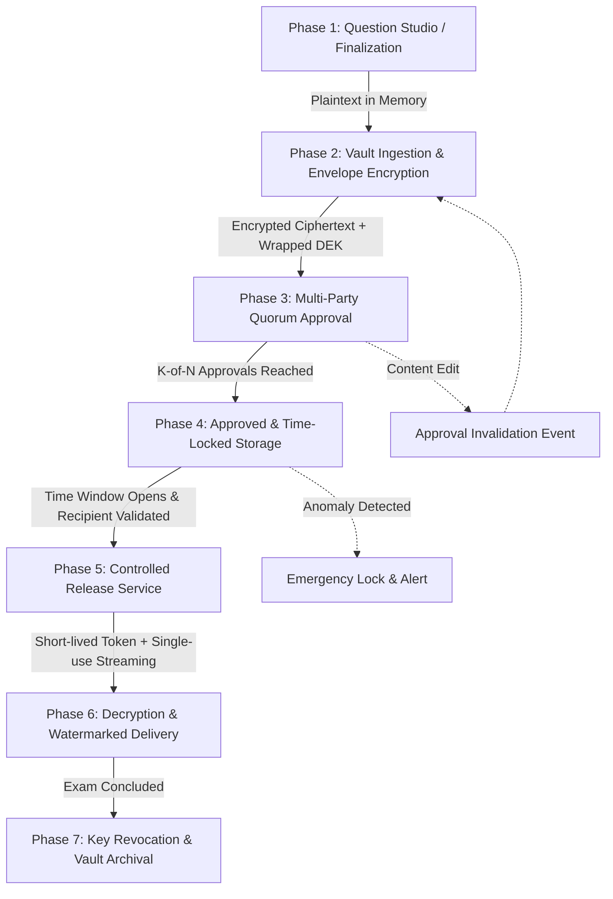

# Exam OS Secure Paper Vault — Threat Model & Security Architecture

## 1. Executive Summary & Lifecycle Threat Modeling

The Exam OS Secure Paper Vault is designed to protect high-stakes university examination papers across their end-to-end lifecycle: from finalization in the Question Paper Studio to long-term encrypted vault storage, multi-party quorum approval, scheduled time-locked release, and authorized printing.

### Paper Lifecycle Phases



---

## 2. STRIDE Threat Analysis Across Lifecycle

| STRIDE Category | Threat Description | Vulnerable Component | Technical Countermeasure |
| :--- | :--- | :--- | :--- |
| **Spoofing** | Adversary impersonates an approved approver, HOD, or printer. | Authentication / RBAC | Argon2id + mandatory TOTP MFA for privileged approvers; object-level session verification. |
| **Tampering** | Rogue DBA or actor modifies ciphertext on disk or alters question point values. | Private Storage / Database | Authenticated encryption (AES-256-GCM) with AAD (paper ID, version, department, time window). Any modification causes MAC tag verification failure (`ValueError`). |
| **Repudiation** | Approver or setter denies modifying, invalidating, or releasing a paper. | Audit Trail | Tamper-evident SHA-256 cryptographic hash-chained audit logging (`prev_hash` + event payload). |
| **Information Disclosure** | Plaintext paper leaked via logs, error messages, browser cache, or direct storage URLs. | App Logging / Storage / HTTP Headers | Private storage with public access disabled; `Cache-Control: no-store, no-cache, private`; zero plaintext in logs filter; ephemeral in-memory DEKs. |
| **Denial of Service** | Corrupted or lost master key renders all past and upcoming examinations permanently inaccessible. | Key Management Service | Documented key escrow, multi-custodian secret recovery, versioned KEKs, and offline HSM backup replicas. |
| **Elevation of Privilege** | Setter approves own paper, or single ordinary role bypasses multi-party release. | Quorum & Release Service | Strict separation of duties: Author cannot approve (`created_by != approver_id`); configurable $K$-of-$N$ multi-approver quorum; dual-controller sign-off. |

---

## 3. Cryptographic Architecture & Envelope Encryption

### 3.1 Data Encryption Key (DEK) & Key Encryption Key (KEK) Hierarchy

```
+-------------------------------------------------------------------+
|               Hardware Security Module (HSM) / KMS               |
|                                                                   |
|   +-----------------------------------------------------------+   |
|   | Master Key (KEK): AES-256-GCM (Versioned: v1, v2, ...)     |   |
|   | Never leaves the KMS boundary / Never committed to code   |   |
|   +-----------------------------------------------------------+   |
+-------------------------------------------------------------------+
                                  |
                                  | Wrap / Unwrap DEK (AES-256-GCM)
                                  v
+-------------------------------------------------------------------+
|                      Exam OS Application Vault                    |
|                                                                   |
|   +-----------------------+     +-----------------------------+   |
|   | Unique per-paper DEK  |     | Wrapped DEK (Base64)        |   |
|   | 256-bit CSPRNG        | --> | Stored in metadata table    |   |
|   | (Zeroized post-crypto)|     | Safe to store in DB         |   |
|   +-----------------------+     +-----------------------------+   |
|               |                                                   |
|               v AES-256-GCM + AAD                                 |
|   +-----------------------------------------------------------+   |
|   | Authenticated Paper Ciphertext + 128-bit Authentication   |   |
|   | Tag + 96-bit Nonce. Stored in private vault filesystem    |   |
|   +-----------------------------------------------------------+   |
+-------------------------------------------------------------------+
```

### 3.2 Authenticated Additional Data (AAD) Binding
The GCM authentication tag authenticates both the ciphertext and the following non-negotiable metadata parameters:
- `paper_id` & `paper_code`
- `version`
- `department`
- `scheduled_release_start` & `scheduled_release_end`

If an adversary alters any metadata row in the SQL database, decryption will fail because the GCM tag verification detects an AAD mismatch.

---

## 4. Multi-Party Quorum Governance ($K$-of-$N$)

For sensitive examinations (e.g. End-Semester, Competitive Entrance, University Central Examinations):
- **Configurable Threshold**: Minimum $K$ distinct approvals required (e.g., $K=2$: 1 HOD + 1 Controller of Examinations).
- **Separation of Duties (SoD) Invariants**:
  1. $\text{Author} \ne \text{Approver}_i$ (Self-approval strictly forbidden).
  2. $\text{Approver}_i \ne \text{Approver}_j$ (No duplicate votes by the same individual).
  3. $\text{Approver}_i \ne \text{KMS Administrator}$ (Key custodians cannot act as examination reviewers).
  4. $\text{Any Content Edit} \implies \text{All Approvals Revoked}$ (Invalidation trigger; version increments).

---

## 5. Controlled Scheduled Release Service

Access to decrypted paper content is governed by a time-lock release service:
1. **Status Assertion**: Status must be `approved_locked`.
2. **Version Lock**: Requested paper version must match the finalized approved version.
3. **Quorum Verification**: Total verified approvals $\ge K$.
4. **Time-Lock Window**:
   $$T_{\text{release\_start}} \le T_{\text{current\_utc}} \le T_{\text{release\_end}}$$
   - Early attempts trigger an immediate `EARLY_RELEASE_ATTEMPT` security alert, increment risk scores, and refuse decryption.
   - Late attempts beyond the grace window are refused.
5. **Recipient Authorization**:
   - Recipient must hold `Permission.PRINT_PAPERS` or `Permission.APPROVE_RELEASE`.
   - Recipient user account must be active (`is_active = True`), unrevoked, and free from lockout.
   - Department boundary enforced.
6. **Delivery Controls**:
   - Decrypted in-memory only; never written to temporary disk files.
   - Dynamic recipient watermarking: Embeds recipient email, client IP, and UTC timestamp diagonally across every page.
   - HTTP Headers: `Cache-Control: no-store, no-cache, must-revalidate, private`, `Pragma: no-cache`.

---

## 6. Incident Response, Key Rotation & Residual Risks

### 6.1 Emergency Invalidation & Lock
If a leak suspicion or procedural anomaly is detected:
- The Controller of Examinations triggers `emergency_lock(paper_id)`.
- Status transitions to `emergency_locked`.
- All active release tokens are immediately revoked.
- High-severity institutional alert logged to security officers.

### 6.2 Key Rotation Procedure
- **Zero Downtime Re-wrapping**: The KMS generates Master Key KEK v2.
- A batch job decrypts existing wrapped DEKs using KEK v1 and re-encrypts them under KEK v2.
- *Notice*: Paper ciphertext does not need to be re-encrypted, meaning multi-gigabyte paper vaults can be rotated in seconds without exposing plaintext content.

### 6.3 Documented Residual Risks
1. **Physical Screen Photography / Optical Exfiltration**:
   > [!WARNING]
   > Cryptography protects data in transit and at rest, but cannot physically prevent an authorized viewer from photographing a screen or printed document with an external camera.
   - *Mitigation*: Forensic watermarking (viewer email, timestamp, IP) permanently stamped across pages to trace leaked images back to the responsible recipient.
2. **Compromised Host OS / Root Key Extraction**:
   - If an attacker gains ring-0 or kernel memory access on the application host, memory inspection of ephemeral keys is theoretically possible.
   - *Mitigation*: Dedicated KMS/HSM boundary, air-gapped production deployment, non-root application processes, and memory zeroization.
